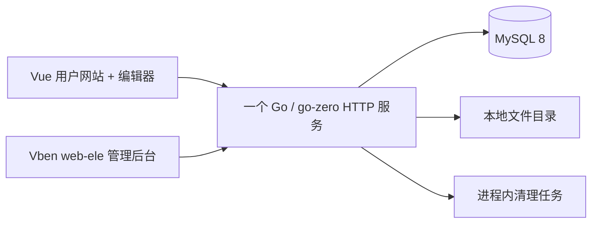

# 后端与双前端技术方案

状态：内部版后端已实现 B1—B6 与 B8 接口；以下保留架构依据，实际字段、表名与契约以 app/design/api 为准。

实施更新（2026-11-26）：模块化单体、schema 3、MySQL 租约任务队列，服务商密钥加密存储。B7 会员支付排除。AI 未接真实厂商，批量渲染通过可选的受信外部 renderer 适配；默认不启用。用户站与后台 Vue 页面尚未交付。

## 1. 架构决策

采用 go-zero REST 模块化单体，单进程提供公开接口、用户接口、管理接口与文件访问。模块通过 Go 方法调用，共享 MySQL 事务，不通过内部 gRPC 调用。



默认运行依赖：一个 Go 后端二进制、一份外置配置、MySQL 8 数据库、可写的文件目录。无需 Docker、Node.js 后端、Redis、Kafka、etcd、Nginx 或独立 RPC。线上 HTTPS 可由部署环境的反向代理终止。

用户网站与后台是两个 Vue 构建产物；开发时分别启动 Vite，发布后可由同一 Go 服务提供 `web/site` 和 `web/admin` 静态文件，分别映射 `/` 与 `/admin/`。API 和文件路由优先于 SPA fallback。初期资源外置，后期可选择 go:embed；不要把上传文件编译进二进制。

## 2. 现有仓库复用与隔离

已确认当前模块为 `looklook`，go-zero v1.7.3；业务是民宿，包含 usercenter、travel、order、payment 与 mqueue。

- 复用 Go 模块依赖、go-zero REST、MySQL 工具、错误处理思路与目录约定。
- 新建 `app/design`，不把民宿 RPC 一起启动。既有 usercenter Model 带 Redis 缓存，不直接沿用为新服务强依赖；新建无缓存的数据访问层。
- 旧登录使用 MD5，旧刷新字段不等于实现刷新会话；新模块使用 bcrypt 和持久化会话，不直接照搬旧鉴权逻辑。
- 内部版不开发会员支付，不复用旧民宿支付接口。
- 使用新数据库 `looklook_design` 和 `design_` 表前缀，初始化迁移不得 DROP 原业务表。旧用户数据迁移不是首版范围。
- 编译目标精确到新入口。当前 `data/usercenter-comment-review/before` 是备份代码，其 internal 导入会导致 `go test ./...` 失败；新模块检查范围用 `./app/design/...`，不在本次顺带改动备份。

建议目录：

```text
app/design/
  cmd/server/main.go
  etc/design.example.yaml
  api/                         # 按模块拆分 goctl .api 源定义
  internal/
    config/ middleware/ transport/ svc/
    modules/
      identity/                # 账号、会话、管理员与权限
      catalog/                 # 分类、模板、专题
      asset/                   # 图片、字体、存储与引用
      workspace/               # 作品、保存、回收站
      operation/               # 审计、收藏、指标
      task/                    # 配置、任务、额度和 worker
    platform/database/ storage/ clock/
  migrations/                  # 顺序 SQL，go:embed 随二进制发布
  tests/
web/site/                      # 用户端生产静态资源部署目录
web/admin/                     # 管理端生产静态资源部署目录
```

模块内分 handler/logic/repository/model；handler 只做协议处理，logic 校验权限和业务规则，repository 管理 SQL。跨模块通过显式接口调用；事务边界由用例层控制。先不抽成新的 Go module。

## 3. 数据与一致性

| 模块 | 主要表 | 关键约束 |
| --- | --- | --- |
| 身份 | design_users、design_admins、design_sessions | 规范化用户名唯一；密码摘要；会话摘要、类型、有效期与撤销状态 |
| 权限 | design_roles、design_permissions、design_admin_roles、design_role_permissions | 关联唯一；权限码如 template:publish；保护最后一位超级管理员 |
| 内容 | design_categories、design_templates、design_template_revisions、design_template_tags | 草稿修订与已发布修订分开；分类状态；发布状态索引 |
| 文件 | design_assets、design_asset_references | owner/type/storage_key/size/hash/status；引用对象与资源组合唯一 |
| 作品 | design_designs、design_history | owner/title/engine/schema_version/document_json/version/deleted_at；历史快照 B6 启用 |
| 运营 | design_audit_logs、design_export_events | actor/action/target/request_id；导出事件 user_id + event_id 唯一 |
| B6 | design_favorites、design_folders、design_topics、design_topic_templates | 用户收藏唯一、文件夹所有权、专题排序 |
| B8 | design_jobs、design_job_attempts | 状态、重试次数、租约、幂等键与成本记录 |

所有业务 ID 在 JSON 中用字符串，避免 JavaScript 大整数丢精度。数据库统一 UTC 时间，API 用 RFC3339；前端按用户时区显示。分页结果为 `{items,total,page,pageSize}`。

作品保存 `UPDATE ... WHERE id=? AND owner_id=? AND version=?`，成功后递增版本。文档 JSON、资源引用和额度变动在同一事务提交。版本不匹配返回 409 与最新版本号，不覆盖内容。

文档暂按一页 JSON 存 MySQL，最大 5 MiB、最多 2000 个对象；对引擎、协议版本、对象数量、图片和字体引用进行校验。超限拒绝。大文档拆分应通过协议升级，不临时放宽到无限大小。

上传采用临时文件 → 格式校验 → 磁盘原子移动 → 数据库登记；失败补偿清理。额度更新使用事务和行锁，避免并发超额。定时任务清理未引用临时资源与过期回收站，采用 MySQL 锁防止重复执行。停机不丢用户数据，下次启动可继续清理。

## 4. 鉴权与权限

- 用户与管理员独立账号表、独立 token audience、独立刷新 Cookie 名和 path；任何用户 token 都不能通过管理端鉴权。
- access token 默认 15 分钟；refresh token 为高熵随机串，数据库仅存摘要，最长 7 天，刷新时旋转并作废旧值。修改密码、封禁、退出均撤销相关会话。
- 每个受保护请求校验 token 签名、issuer/audience/exp，以及数据库会话和账号状态，保证撤销立即生效。初期不依赖 Redis。
- refresh token 使用 HttpOnly Cookie；生产 Secure、SameSite=Lax；开发可在 localhost 上关闭 Secure。刷新和退出检查 Origin，跨域仅允许配置中的两个前端来源，禁止凭据请求使用 `*`。
- 用户注册和管理员登录都进行长度限制与尝试频率限制，第一版以单进程限流实现，重启会重置，禁止对外承诺分布式限流。
- 启动不得创建固定密码管理员；通过交互式 `admin create` 子命令初始化，密码不放命令行参数或日志。
- 私有作品、文件查询同时检查 owner_id；ID 难猜不能替代权限校验。管理员访问私有内容须另设显式权限及审计，默认关闭。

## 5. API 协议

公共前缀 `/api/v1`；管理员前缀 `/api/admin/v1`。JSON 成功：

```json
{"code":0,"message":"ok","data":{"id":"123"},"requestId":"..."}
```

错误保留相同结构，data 可为 null。HTTP 使用 400 参数错误、401 未登录/会话失效、403 无操作权限、404 资源不存在或不属于用户、409 版本/状态冲突、413 大小超限、429 请求过快、500 内部错误、503 依赖不可用。业务错误码按模块划分；401 的响应也必须保持统一格式，日志记录 requestId，不返回 SQL、密钥或密码。

创建作品、套用模板使用 `Idempotency-Key`，按主体、路由和 key 去重，24 小时有效；同 key 不同请求内容返回 409。第一版可存 MySQL 幂等记录表 `design_idempotency_keys`，不得只靠前端防重复点击。

### 5.1 接口清单与批次

下表路径为相对前缀；精确字段以每批提交的 `.api` 和 OpenAPI 文档为准。

| 批次 | 用户/公开接口 `/api/v1` | 管理接口 `/api/admin/v1` |
| --- | --- | --- |
| B1 | POST /auth/register、/auth/login、/auth/refresh、/auth/logout；GET /me；PATCH /me；PUT /me/password | POST /auth/login、/auth/refresh、/auth/logout；GET /user/info、/auth/codes；管理员、角色权限及用户状态管理 |
| B2 | GET /home、/categories、/templates、/templates/:id | 分类与模板草稿 CRUD；POST /templates/:id/publish、/offline |
| B3 | POST /assets；GET /assets、/assets/:id/content；DELETE /assets/:id；GET /fonts | 公共素材与字体上传、列表、状态管理、引用查询 |
| B4 | POST /designs、/templates/:id/use；GET /designs、/designs/:id；PUT /designs/:id/document；PATCH /designs/:id；POST /designs/:id/copy | 模板编辑数据读写与编辑预览；修订发布校验 |
| B4 | DELETE /designs/:id；GET /trash；POST /designs/:id/restore；DELETE /trash/:id | 查询模板引用，不开放随意查看用户作品 |
| B5 | POST /designs/:id/export-check；POST /export-events；POST /designs/:id/cover | 导出事件和异常概览 |
| B6 | 收藏、文件夹、作品历史、专题列表与详情 | 首页配置、专题维护、统计报表 |
| B8 | AI 任务、任务查询/取消、批量导出 | 服务商、任务、额度和失败重试 |

健康检查独立使用 `/healthz`（存活）与 `/readyz`（数据库、迁移版本、存储目录可用）。readiness 失败返回 503，不能只返回固定字符串。

### 5.2 第一批字段基线

- 注册：`username,password`；username 3—32 位，首版只允许字母、数字、下划线；密码 8—72 UTF-8 字节，bcrypt；注册成功返回用户 ID，不自动创建管理员。
- 登录：`username,password` → `accessToken,expiresAt`，同时写入对应刷新 Cookie。
- 刷新：读取 Cookie → 同样返回 `accessToken,expiresAt`，旋转 Cookie；失效返回 401。
- 当前用户：`id,username,nickname,avatar,status`；管理员用户信息适配 Vben 的 `userId,username,realName,avatar,roles,homePath` 等实际类型。
- 权限码：`data` 为字符串数组。Vben 固定路由按这些码过滤，不把菜单访问当成接口授权。
- 修改密码：`oldPassword,newPassword`，成功后撤销会话，返回登录页。
- 管理端列表：统一分页、关键字、状态筛选；PATCH 用户状态需要 `user:status`，写审计。

现有 Vben 请求客户端已经使用 `code=0/data/message`。其刷新逻辑目前期望 data 为字符串，需要联调时改为读取 `data.accessToken`；管理员 baseURL 指向 `/api/admin/v1`。不能假定现有 mock API 无修改即可接入。用户站请求客户端独立配置 `/api/v1`。

## 6. 文件存储与编辑器适配

文件在配置根目录内按随机 key 存储，不使用客户端路径或原始文件名作为磁盘路径。公共已发布封面可公开缓存；私有文件通过 token 或短期资源授权访问，静态服务器不得直接暴露整个上传目录。

数据库保存稳定 asset ID 与 storage key。编辑器适配器负责把资源引用替换为临时可访问地址，保存时恢复 ID；字体等待加载后才能导出。服务端校验文档内所有资源引用的可访问性。首版禁止远程任意 URL 导入，避免 SSRF 和导出跨域污染。

首版模板必须只有公共发布资源。用户作品引用的资源按引用表保留；用户删除素材时有引用则返回 409 并提示影响范围。历史版本、模板已发布版本也属于有效引用。

B5 导出检查不承担浏览器渲染；内部版没有付费权益。B8 批量任务通过受信渲染服务生成结果，未配置时不能执行。

## 7. 构建、配置和运维

目标命令（B1 实现后才可执行）：

```powershell
go build -o dist/design-server.exe ./app/design/cmd/server
.\dist\design-server.exe migrate -f .\app\design\etc\design.yaml
.\dist\design-server.exe admin create -f .\app\design\etc\design.yaml
.\dist\design-server.exe serve -f .\app\design\etc\design.yaml
```

使用无 CGO 的依赖路线，Linux/Windows 分别构建各自二进制。未来 CI 验证 `CGO_ENABLED=0` 构建，不能把 exe 拷到 Linux 直接运行。

配置分 HTTP 地址/端口、MySQL DSN、JWT 密钥、允许来源、文件目录、两端静态目录和上传额度；提供 example，不提交真实密码。MySQL 用户由运维预先创建，migrate 只管理目标库表并记录迁移版本；失败中止，禁止带错误继续启动。数据库连接或密钥配置无效时明确退出。

运行具备结构化日志、requestId、panic 恢复、请求超时、SQL 超时、优雅退出、有限文件权限。后台操作写持久化审计；日志不得记录密码、token、完整作品内容。

备份同时覆盖 MySQL 和文件目录，记录一致性时间点；恢复演练验证模板、用户作品和资源都能打开。迁移前备份，回退须评估 schema 兼容，不宣称所有 SQL 可自动回滚。

## 8. 测试与边界

每批交付业务单测、真实 MySQL 的必要集成测试、API 冒烟脚本和双前端相关联调记录。重点测试所有权、会话撤销、并发保存、资源引用、幂等、迁移和重启持久化。B5 做浏览器真实保存/导出回归，不只检查 HTTP 200。

不把增加微服务数量当作扩容方案。出现明确瓶颈后再增加 Redis、对象存储、独立任务 worker；多实例前需先实现共享文件存储、共享限流和任务租约。
