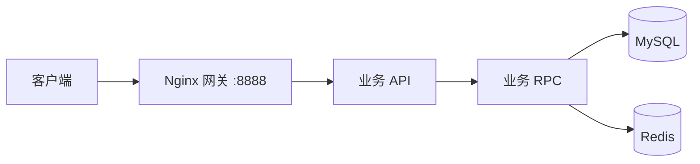

# 认识项目结构

本项目是一个民宿预订后端示例。业务主要包含用户中心、民宿、订单和支付；后台进程负责消息消费、延迟任务和定时任务。

阅读本篇后，你应当能从一个 HTTP 接口找到业务逻辑、RPC 调用和数据库代码。

## 区分框架与项目

go-zero 提供 HTTP 服务、RPC、配置读取、数据库访问、缓存以及服务治理等能力。`goctl` 是配套代码生成工具，可以根据接口定义生成代码骨架。

go-zero-looklook 是使用这些能力实现的业务项目。注册用户、计算订单金额和处理支付状态是本项目的业务逻辑，不是框架自动提供的功能。

| 术语 | 含义 | 项目中的例子 |
| --- | --- | --- |
| API | 对客户端提供的 HTTP 接口 | `POST /usercenter/v1/user/login` |
| RPC | 进程之间的远程过程调用 | API 调用 `UsercenterRpc.Login` |
| gRPC | 本项目使用的 RPC 通信框架 | `usercenter-rpc` 监听 `2004` |
| Protocol Buffers | 定义消息和 RPC 服务的格式，简称 protobuf | `usercenter.proto` |
| handler | 解析 HTTP 请求并组织响应的入口 | `registerHandler.go` |
| logic | 业务逻辑实现 | `registerLogic.go` |
| ServiceContext | 进程共享依赖的集合 | 配置、RPC 客户端、Model |
| Model | 数据库访问层 | `UserModel.FindOneByMobile` |
| JWT | JSON Web Token，用于携带签名后的身份声明 | 登录返回的 `accessToken` |
| 中间件 | 在 HTTP 业务处理前后执行的逻辑 | 校验 JWT |
| 拦截器 | 在 RPC 调用前后执行的逻辑 | 记录并转换 RPC 错误 |

## 查看顶层目录

```text
go-zero-looklook-main/
├── app/
│   ├── usercenter/       用户中心
│   ├── travel/           民宿房源、商家、评论
│   ├── order/            订单与支付状态消息消费
│   ├── payment/          支付流水与微信支付接口
│   └── mqueue/           延迟任务、任务执行、定时调度
├── pkg/                 业务共享的工具和约定
├── deploy/
│   ├── sql/             四个业务库的初始化 SQL
│   ├── goctl/           自定义代码生成模板压缩包
│   ├── script/          代码生成命令与辅助脚本
│   ├── nginx/           网关配置
│   ├── prometheus/      指标采集配置
│   ├── filebeat/        日志采集配置
│   └── go-stash/        日志处理配置
├── data/                本地运行数据与产物，默认被 Git 忽略
├── doc/                 原教程与本指南
├── docker-compose-env.yml  基础设施容器
├── docker-compose.yml      业务开发容器与 Nginx
├── modd.conf            Go 文件变动后的编译与进程重启规则
├── go.mod               模块与依赖版本
└── go.sum               依赖校验信息
```

原 README 中的 `common` 对应当前的 `pkg`。导入项目代码时使用模块路径，例如 `looklook/pkg/result`，不要使用磁盘目录名作为 Go 导入路径。

## 理解一次请求经过的进程

完整容器开发环境的主要调用方向是：



入门教程直接访问宿主机上的 `usercenter-api:1004`，省略 Nginx。API 与 RPC 是两个独立 Go 进程：API 处理 HTTP，RPC 处理可复用的业务和数据库访问。

当前 Nginx 配置按 `/usercenter/`、`/travel/`、`/order/`、`/payment/` 转发请求。JWT 校验由 API 路由启用的 go-zero 中间件完成，当前代码没有单独的 `app/identity` 服务。

部分简单业务也可能直接写在 API logic 中。因此，“API 聚合、RPC 承担核心业务”是项目的组织方式，不代表框架禁止 API 访问数据库。

## 找到用户中心入口

用户中心的目录可以作为其他服务的阅读模板：

```text
app/usercenter/
├── cmd/api/
│   ├── usercenter.go       HTTP 进程入口
│   ├── desc/              .api 接口定义
│   ├── etc/               YAML 配置
│   └── internal/
│       ├── config/        配置结构体
│       ├── handler/       路由和 HTTP 处理器
│       ├── logic/         API 业务逻辑
│       ├── svc/           API 依赖初始化
│       └── types/         HTTP 请求与响应类型
├── cmd/rpc/
│   ├── usercenter.go       RPC 进程入口
│   ├── pb/                .proto 和生成的协议代码
│   ├── usercenter/        生成的 RPC 客户端封装
│   ├── etc/               YAML 配置
│   └── internal/
│       ├── config/        配置结构体
│       ├── server/        RPC 服务方法到 logic 的转发
│       ├── logic/         RPC 业务逻辑
│       └── svc/           数据库、缓存等依赖初始化
└── model/                 数据访问代码
```

Go 的 `internal` 目录有导入范围限制。跨服务调用应使用生成的 RPC 客户端，不要直接导入另一个服务的 `internal/logic`。

## 选择源码阅读顺序

先阅读一个完整功能，再扩展到其他模块：

1. 在 [usercenter.api](E:/go/go-zero-looklook-main/app/usercenter/cmd/api/desc/usercenter.api) 找接口路径、HTTP 方法和鉴权声明。
2. 在 [user.api](E:/go/go-zero-looklook-main/app/usercenter/cmd/api/desc/user/user.api) 找请求与响应字段。
3. 在 [registerHandler.go](E:/go/go-zero-looklook-main/app/usercenter/cmd/api/internal/handler/user/registerHandler.go) 找参数解析和响应包装。
4. 在 [API registerLogic.go](E:/go/go-zero-looklook-main/app/usercenter/cmd/api/internal/logic/user/registerLogic.go) 找 RPC 调用。
5. 在 [RPC registerLogic.go](E:/go/go-zero-looklook-main/app/usercenter/cmd/rpc/internal/logic/registerLogic.go) 找事务和业务规则。
6. 在 [userModel_gen.go](E:/go/go-zero-looklook-main/app/usercenter/model/userModel_gen.go) 找实际 SQL 和缓存操作。

第二轮再阅读两个 `usercenter.go` 和 `svc/serviceContext.go`，理解配置如何变成运行时依赖。`NewServiceContext` 通常在进程启动时调用，logic 对象则围绕请求创建；不要在每次请求中重复创建数据库或 RPC 客户端。

## 了解其他服务的职责

| 服务或进程 | 职责 | 建议学习时机 |
| --- | --- | --- |
| `usercenter-api/rpc` | 注册、登录、身份信息 | 第一阶段 |
| `travel-api/rpc` | 民宿信息、商家、评论与活动 | 能跟踪用户请求后 |
| `order-api/rpc` | 创建、查询和更新订单 | 理解 RPC 与 Model 后 |
| `payment-api/rpc` | 支付流水、微信预支付、支付回调 | 具备微信测试条件后 |
| `order-mq` | 消费 Kafka 支付状态消息 | 学习异步业务时 |
| `mqueue-job` | 执行 Asynq 任务 | 学习延迟关闭订单时 |
| `mqueue-scheduler` | 按计划投递任务 | 理解任务执行与调度的区别后 |

下一步：[运行用户中心](02-运行用户中心.md)。
