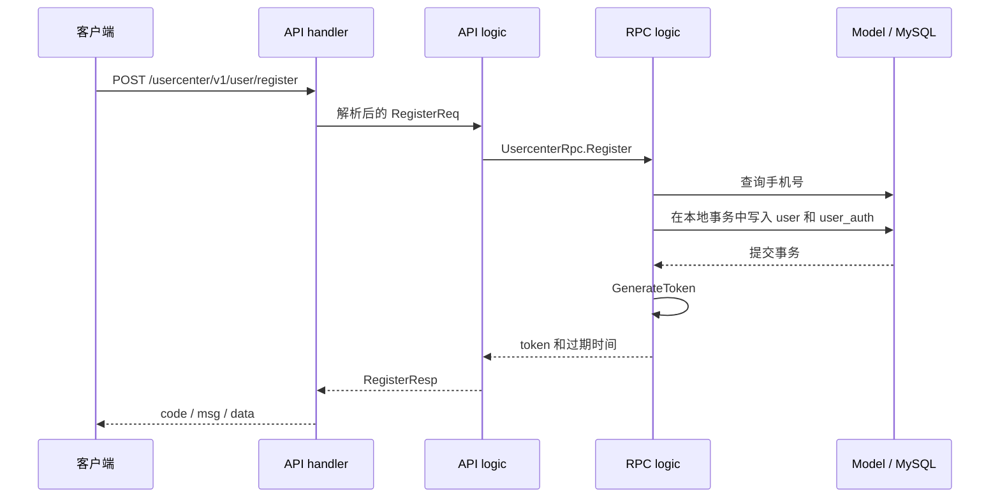

# 跟踪请求和业务流程

本篇从已经运行的注册接口出发，说明每一层负责什么，再介绍鉴权、缓存和异步业务。阅读前先完成[运行用户中心](02-运行用户中心.md)。

## 跟踪注册请求

注册请求的主要路径如下：



### 找到接口定义

[usercenter.api](E:/go/go-zero-looklook-main/app/usercenter/cmd/api/desc/usercenter.api) 定义了路径前缀 `usercenter/v1`、handler 名称 `register` 和相对路径 `/user/register`。组合后的地址是 `/usercenter/v1/user/register`。

[user.api](E:/go/go-zero-looklook-main/app/usercenter/cmd/api/desc/user/user.api) 定义 `RegisterReq` 和 `RegisterResp`。HTTP 类型和 protobuf 类型分别服务于不同协议；即使字段相同，也属于不同的结构体。

### 查看 handler

[registerHandler.go](E:/go/go-zero-looklook-main/app/usercenter/cmd/api/internal/handler/user/registerHandler.go) 主要执行三件事：

1. 用 `httpx.Parse` 将请求解析到 `types.RegisterReq`。
2. 创建请求对应的 `RegisterLogic` 并调用 `Register`。
3. 用 `result.HttpResult` 包装响应。

参数解析失败时调用 `result.ParamErrorResult`。handler 负责协议处理；业务条件，例如手机号规则和密码要求，应明确写在相应的业务逻辑中。定义了字符串字段，不代表已经校验了全部业务约束。

### 查看 API logic

[API registerLogic.go](E:/go/go-zero-looklook-main/app/usercenter/cmd/api/internal/logic/user/registerLogic.go) 把手机号、密码和登录类型转换成 RPC 请求，再调用 `l.svcCtx.UsercenterRpc.Register`。

`svcCtx.UsercenterRpc` 在 [API serviceContext.go](E:/go/go-zero-looklook-main/app/usercenter/cmd/api/internal/svc/serviceContext.go) 中创建，连接地址来自 `UsercenterRpcConf.Endpoints`。配置中的 `NonBlock: true` 允许客户端非阻塞初始化，不能据此认定 RPC 服务已可用。

### 查看 RPC logic 和事务

[RPC registerLogic.go](E:/go/go-zero-looklook-main/app/usercenter/cmd/rpc/internal/logic/registerLogic.go) 先查询手机号是否存在，再通过 `UserModel.Trans` 启动数据库事务，在同一事务中写入：

| 表 | 保存的信息 |
| --- | --- |
| `user` | 手机号、密码摘要、昵称等用户信息 |
| `user_auth` | 用户 ID、登录类型与登录标识的关联 |

关键是把事务回调中的同一个 `session` 传给两次 `Insert`。事务内任一步失败就返回错误，避免只写入一张表。

这属于同一 MySQL 数据库中的本地事务，不是跨服务分布式事务。JWT 在事务提交后生成，签发令牌不属于数据库事务。

当前登录实现使用 `tool.Md5ByString` 比较密码摘要。这是仓库现状；在正式系统中设计密码存储时，应使用 bcrypt 或 Argon2 等适合密码存储的算法，不要把本示例视为生产密码方案。

## 理解登录与 JWT

登录接口调用 RPC 的 `Login`，查询用户并校验密码，然后复用 [generateTokenLogic.go](E:/go/go-zero-looklook-main/app/usercenter/cmd/rpc/internal/logic/generateTokenLogic.go) 签发 JWT。

当前 JWT 包含 `iat`（签发时间）、`exp`（过期时间）和 `jwtUserId`（用户 ID），使用 HS256 签名。JWT 是签名的身份声明，不是加密存储；不要放入密码等秘密信息。

| 字段 | 作用 |
| --- | --- |
| `accessToken` | 请求受保护接口时放入 `Authorization: Bearer ...` |
| `accessExpire` | 令牌过期时的 Unix 秒时间戳 |
| `refreshAfter` | 建议刷新时点，当前实现为签发时间加有效期的一半 |

返回 `refreshAfter` 并不代表已实现自动刷新。当前用户 API 定义中没有独立刷新接口，入门时过期后重新登录。

用户详情路由通过 [routes.go](E:/go/go-zero-looklook-main/app/usercenter/cmd/api/internal/handler/routes.go) 中的 `rest.WithJwt` 启用鉴权。API 验证签名与过期时间后，[detailLogic.go](E:/go/go-zero-looklook-main/app/usercenter/cmd/api/internal/logic/user/detailLogic.go) 使用 `ctxdata.GetUidFromCtx` 读取用户 ID，再调用 RPC 查询用户。

由此可以解释两个常见现象：

- API 与 RPC 的 `AccessSecret` 不同，会导致登录成功但查询详情返回 401。
- 修改客户端请求体中的用户 ID 不会改变详情接口查询的身份，因为该接口从已验证的 JWT 读取 ID。

当前 `wxMiniAuth` 也在 JWT 保护的路由组中。不要假设它像普通登录接口一样可以匿名调用；微信授权还需要真实小程序配置，超出本入门练习范围。

## 理解 Model 和缓存

[RPC serviceContext.go](E:/go/go-zero-looklook-main/app/usercenter/cmd/rpc/internal/svc/serviceContext.go) 使用 `DB.DataSource` 创建 MySQL 连接，用 `Cache` 创建带缓存的 Model。

| 文件类型 | 作用 | 修改方式 |
| --- | --- | --- |
| `userModel_gen.go` | 生成的 SQL、缓存键、增删改查方法 | 从模板和表结构重新生成 |
| `userModel.go` | 自定义 Model 的扩展入口 | 添加自定义接口和方法 |
| `vars.go` | 公共错误等约定 | 按项目约定维护 |

带缓存的单条查询通常先查 Redis，未命中时查数据库。查询和更新是否走缓存，应以具体方法实现为准；不是所有自定义列表查询都自动缓存。

go-zero 的 singleflight 用于合并同一进程内对同一键的并发加载，不是跨所有服务实例的分布式锁。自定义写入方法要同时考虑缓存失效；直接在数据库客户端修改数据后，应用可能暂时读到旧缓存。

## 理解错误如何返回

错误处理由三部分协作：

1. `pkg/xerr` 定义业务错误码和面向客户端的消息。
2. [loggerInterceptor.go](E:/go/go-zero-looklook-main/pkg/interceptor/rpcserver/loggerInterceptor.go) 记录 RPC 错误，并把业务错误转换为 gRPC 错误。
3. [httpResult.go](E:/go/go-zero-looklook-main/pkg/result/httpResult.go) 识别业务错误并包装 HTTP 响应。

当前实现的成功响应为 HTTP 200，业务字段为 `code: 200`；`HttpResult` 的业务失败返回 HTTP 400。错误响应通常只有 `code` 和 `msg`，不一定有 `data`。JWT 中间件、路由不存在和框架错误可能使用不同的响应格式。

新增错误时应同步维护 `errCode.go` 与 `errMsg.go`，否则错误码可能无法被 `IsCodeErr` 识别。日志补充定位信息时，避免记录密码、完整 token 或支付密钥。

## 阅读订单和异步任务

理解用户服务后，可以按照“创建订单 → 延迟关闭 → 支付通知”的顺序阅读。

### 创建订单和延迟关闭

[createHomestayOrderLogic.go](E:/go/go-zero-looklook-main/app/order/cmd/rpc/internal/logic/createHomestayOrderLogic.go) 查询民宿信息、计算金额并写入订单，然后向 Asynq 投递延迟任务。

当前常量 `CloseOrderTimeMinutes` 为 **30 分钟**。任务到期后由 [closeOrder.go](E:/go/go-zero-looklook-main/app/mqueue/cmd/job/internal/logic/closeOrder.go) 查询订单，只有仍处于待支付状态时才尝试取消。

Asynq 基于 Redis。生产者成功投递任务后，还需要 `mqueue-job` 持续运行，任务才会被处理。返回错误会触发任务重试，因此处理逻辑需要考虑重复执行。

当前创建订单代码在延迟任务投递失败时记录错误，并仍可能返回订单创建成功。数据库写入与任务投递不是一个原子操作，不能仅凭订单创建成功判断延迟关闭一定可执行。

### 支付状态通过 Kafka 传递

设计上的主要路径是：

```text
微信回调 → payment-api → payment-rpc 更新支付流水
                           ↓ Kafka
                  payment-update-paystatus-topic
                           ↓
                       order-mq
                           ↓ RPC
                      order-rpc 更新订单
                           ↓ Asynq
                      mqueue-job 发送通知
```

从 [updateTradeStateLogic.go](E:/go/go-zero-looklook-main/app/payment/cmd/rpc/internal/logic/updateTradeStateLogic.go) 和 [paymentUpdateStatus.go](E:/go/go-zero-looklook-main/app/order/cmd/mq/internal/mqs/kq/paymentUpdateStatus.go) 阅读生产与消费两端。

Kafka 用于服务间消息传递，Asynq 用于任务执行与延迟处理。两者承担的职责不同。当前支付流水更新后，消息发送失败只记录日志；这一流程不能理解为具备跨数据库和 Kafka 的事务保证。

真实支付联调还要逐项核对支付流水号、业务订单号、金额、验签和状态转换。本指南解释代码组织，不把示例消息链路当作已经验证的支付闭环。

### 区分定时调度和任务执行

`mqueue-scheduler` 使用 `*/1 * * * *` 每分钟投递结算示例任务。`mqueue-job` 接收并执行任务。当前 [settleRecord.go](E:/go/go-zero-looklook-main/app/mqueue/cmd/job/internal/logic/settleRecord.go) 仅打印演示消息，没有实现完整结算业务。

原文档中的 DTM 章节介绍另一个示例仓库。当前项目没有把 DTM 集成为运行用户服务的必要组件。

下一步：[开发和验证接口](04-开发和验证接口.md)。
