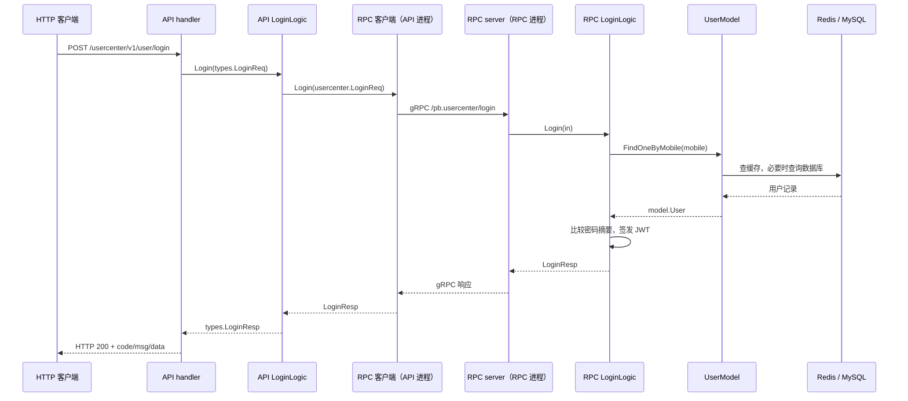

# 按文件跟踪登录接口的完整调用过程

本篇回答一个具体问题：调用 `POST /usercenter/v1/user/login` 后，程序依次进入哪些文件、执行哪些关键代码，最后怎样返回登录令牌？

以当前项目源码为准，核对日期为 2026-10-16。示例代码摘录省略了部分注释或无关分支；完整实现以链接中的文件为准。所有源码链接指向当前机器的绝对路径。

## 先看文件与调用顺序

登录由两个独立进程协作：`usercenter-api` 接收 HTTP，`usercenter-rpc` 查询用户并校验密码。两个进程中都有 `LoginLogic`，它们是不同包中的不同类型。

| 顺序 | 所在位置 | 对应文件 | 重点代码或方法 |
| --- | --- | --- | --- |
| 1 | API 路由 | [cmd/api/internal/handler/routes.go](E:/go/go-zero-looklook-main/app/usercenter/cmd/api/internal/handler/routes.go) | `/user/login`、`user.LoginHandler(serverCtx)` |
| 2 | API handler | [cmd/api/internal/handler/user/loginHandler.go](E:/go/go-zero-looklook-main/app/usercenter/cmd/api/internal/handler/user/loginHandler.go) | `httpx.Parse`、`l.Login(req)` |
| 3 | API logic | [cmd/api/internal/logic/user/loginLogic.go](E:/go/go-zero-looklook-main/app/usercenter/cmd/api/internal/logic/user/loginLogic.go) | `l.svcCtx.UsercenterRpc.Login(...)` |
| 4 | RPC 客户端封装，运行在 API 进程 | [cmd/rpc/usercenter/usercenter.go](E:/go/go-zero-looklook-main/app/usercenter/cmd/rpc/usercenter/usercenter.go) | `defaultUsercenter.Login` |
| 5 | gRPC 客户端，运行在 API 进程 | [cmd/rpc/pb/usercenter_grpc.pb.go](E:/go/go-zero-looklook-main/app/usercenter/cmd/rpc/pb/usercenter_grpc.pb.go) | `c.cc.Invoke(..., "/pb.usercenter/login", ...)` |
| 6 | gRPC 服务端，运行在 RPC 进程 | 同一个生成文件 | `_Usercenter_Login_Handler` 解码、执行拦截器并分发 |
| 7 | RPC server | [cmd/rpc/internal/server/usercenterServer.go](E:/go/go-zero-looklook-main/app/usercenter/cmd/rpc/internal/server/usercenterServer.go) | `UsercenterServer.Login` |
| 8 | RPC logic | [cmd/rpc/internal/logic/loginLogic.go](E:/go/go-zero-looklook-main/app/usercenter/cmd/rpc/internal/logic/loginLogic.go) | `Login` → `loginByMobile` |
| 9 | Model | [model/userModel_gen.go](E:/go/go-zero-looklook-main/app/usercenter/model/userModel_gen.go) | `FindOneByMobile` → 缓存查询或 SQL 查询 |
| 10 | RPC logic | 回到第 8 步的文件 | 比较密码摘要，取得用户 ID |
| 11 | 令牌签发 | [cmd/rpc/internal/logic/generateTokenLogic.go](E:/go/go-zero-looklook-main/app/usercenter/cmd/rpc/internal/logic/generateTokenLogic.go) | `GenerateToken` → `getJwtToken` |
| 12 | API 响应 | [pkg/result/httpResult.go](E:/go/go-zero-looklook-main/pkg/result/httpResult.go) | 返回路径经过 API logic、handler，最终输出 JSON |

其中有两个细节需要补充到原来的简化调用链：RPC 客户端与 RPC logic 之间还有服务端分发层；Model 使用缓存，**不是每次登录都会查询 MySQL**。



## 准备一条登录请求

先按照[运行用户中心](02-运行用户中心.md)启动 API、RPC、MySQL 和 Redis，并注册一个练习账号。登录只查询和验证已有用户，不会自动注册。

本篇使用以下请求作为例子：

```http
POST /usercenter/v1/user/login HTTP/1.1
Host: 127.0.0.1:1004
Content-Type: application/json

{
  "mobile": "13800138000",
  "password": "LearnGoZero2026!"
}
```

在 PowerShell 中发送：

```powershell
$body = @{
    mobile = '13800138000'
    password = 'LearnGoZero2026!'
} | ConvertTo-Json

$login = Invoke-RestMethod -Method Post -Uri 'http://127.0.0.1:1004/usercenter/v1/user/login' -ContentType 'application/json' -Body $body
$login | ConvertTo-Json -Depth 5
```

这里直接访问宿主机 API 的 `1004` 端口。使用完整容器环境时，通常从 Nginx 的 `8888` 端口进入。手机号登录路由不要求已有 JWT，因此请求中无需 `Authorization`。

## 路由决定请求交给哪个 handler

打开 [routes.go](E:/go/go-zero-looklook-main/app/usercenter/cmd/api/internal/handler/routes.go)，找到登录路由：

```go
{
    Method:  http.MethodPost,
    Path:    "/user/login",
    Handler: user.LoginHandler(serverCtx),
},
```

这组路由同时设置了：

```go
rest.WithPrefix("/usercenter/v1")
```

所以完整地址由前缀和相对路径组成：`/usercenter/v1` + `/user/login`。

`LoginHandler(serverCtx)` 在启动时执行，返回一个处理函数；真正的 HTTP 请求到达时，框架执行的是这个返回的函数。路由并不是每次都重新启动一个服务。

路由来源是 [desc/usercenter.api](E:/go/go-zero-looklook-main/app/usercenter/cmd/api/desc/usercenter.api)。需要调整接口时，应修改 `.api` 后生成代码，不直接维护生成的 `routes.go`。

## Handler 把 JSON 转成 Go 请求对象

打开 [loginHandler.go](E:/go/go-zero-looklook-main/app/usercenter/cmd/api/internal/handler/user/loginHandler.go)，关注闭包内的代码：

```go
var req types.LoginReq
if err := httpx.Parse(r, &req); err != nil {
    result.ParamErrorResult(r, w, err)
    return
}

l := user.NewLoginLogic(r.Context(), ctx)
resp, err := l.Login(req)
result.HttpResult(r, w, resp, err)
```

执行到 `httpx.Parse` 之后，`req` 对应如下数据：

```go
types.LoginReq{
    Mobile:   "13800138000",
    Password: "LearnGoZero2026!",
}
```

`types.LoginReq` 位于 [types.go](E:/go/go-zero-looklook-main/app/usercenter/cmd/api/internal/types/types.go)，由 [user.api](E:/go/go-zero-looklook-main/app/usercenter/cmd/api/desc/user/user.api) 生成，`json` 标签决定 JSON 字段与 Go 字段如何对应。

| 代码中的对象 | 作用 |
| --- | --- |
| `r` | 当前 HTTP 请求，包含请求体、请求头和请求上下文 |
| `w` | 用于向客户端写入 HTTP 状态与响应体 |
| `r.Context()` | 当前请求的取消、超时和链路信息；本登录接口没有先验证 JWT |
| `ctx` | `*svc.ServiceContext`，是启动时创建的 API 共享依赖，不是 `context.Context` |
| `l` | 当前请求的 API `LoginLogic` 对象 |

这里先调用 `l.Login(req)` 并等待它返回，最后才执行 `HttpResult`。Handler 没有查数据库，也没有比较密码。

## API logic 转换参数并调用 RPC 客户端

打开 [API loginLogic.go](E:/go/go-zero-looklook-main/app/usercenter/cmd/api/internal/logic/user/loginLogic.go)：

```go
loginResp, err := l.svcCtx.UsercenterRpc.Login(l.ctx, &usercenter.LoginReq{
    AuthType: model.UserAuthTypeSystem,
    AuthKey:  req.Mobile,
    Password: req.Password,
})
if err != nil {
    return nil, err
}
```

HTTP 输入只有手机号和密码，API 在这里补充了 RPC 需要的登录类型：

| HTTP 参数 | RPC 参数 | 本次示例值 |
| --- | --- | --- |
| API 内部补充 | `AuthType` | `"system"` |
| `req.Mobile` | `AuthKey` | `"13800138000"` |
| `req.Password` | `Password` | `"LearnGoZero2026!"` |

`UserAuthTypeSystem` 在 [model/vars.go](E:/go/go-zero-looklook-main/app/usercenter/model/vars.go) 中定义为 `"system"`。这里的 `AuthKey` 是平台登录标识，不是 JWT 签名密钥。

`UsercenterRpc` 的名字虽然含有 RPC，但它在 API 进程中是一个 Go 客户端对象。接下来进入它的 `Login` 方法，而不是直接跳进另一进程的 RPC logic。

## 客户端通过 gRPC 发出网络请求

先打开 [cmd/rpc/usercenter/usercenter.go](E:/go/go-zero-looklook-main/app/usercenter/cmd/rpc/usercenter/usercenter.go)：

```go
func (m *defaultUsercenter) Login(ctx context.Context, in *LoginReq, opts ...grpc.CallOption) (*LoginResp, error) {
    client := pb.NewUsercenterClient(m.cli.Conn())
    return client.Login(ctx, in, opts...)
}
```

`m.cli.Conn()` 取得已有连接，`pb.NewUsercenterClient` 基于连接创建调用代理。目录位于 `cmd/rpc` 不代表这段代码一定运行在 RPC 进程；本次调用中它被 API 导入并运行在 API 进程。

继续打开 [usercenter_grpc.pb.go](E:/go/go-zero-looklook-main/app/usercenter/cmd/rpc/pb/usercenter_grpc.pb.go)，找到客户端的 `Login`：

```go
func (c *usercenterClient) Login(ctx context.Context, in *LoginReq, opts ...grpc.CallOption) (*LoginResp, error) {
    out := new(LoginResp)
    err := c.cc.Invoke(ctx, "/pb.usercenter/login", in, out, opts...)
    if err != nil {
        return nil, err
    }
    return out, nil
}
```

**`c.cc.Invoke(...)` 是进入 gRPC 调用流程的关键位置。** 框架编码 protobuf 请求，通过连接发给 RPC 服务端，等待并解码响应。`/pb.usercenter/login` 是 RPC 方法标识，不是浏览器访问的 HTTP 路由。

这里的 `usercenter.LoginReq` 是 `pb.LoginReq` 的类型别名；它与 HTTP 层的 `types.LoginReq` 不同。前者有 `AuthType/AuthKey/Password`，后者有 `Mobile/Password`。

## RPC 服务端把请求转交给业务 logic

网络请求到达 RPC 进程后，还是由 [usercenter_grpc.pb.go](E:/go/go-zero-looklook-main/app/usercenter/cmd/rpc/pb/usercenter_grpc.pb.go) 中的生成代码处理，但此时执行的是服务端函数 `_Usercenter_Login_Handler`。

它先创建 `LoginReq` 并解码，再通过拦截器调用注册的服务实现。关键分发代码为：

```go
handler := func(ctx context.Context, req interface{}) (interface{}, error) {
    return srv.(UsercenterServer).Login(ctx, req.(*LoginReq))
}
return interceptor(ctx, in, info, handler)
```

这里的 `handler` 是 gRPC 内部回调，不是前面处理 HTTP 的 `LoginHandler`。

打开 [usercenterServer.go](E:/go/go-zero-looklook-main/app/usercenter/cmd/rpc/internal/server/usercenterServer.go)，就能找到真正转入 RPC logic 的代码：

```go
func (s *UsercenterServer) Login(ctx context.Context, in *pb.LoginReq) (*pb.LoginResp, error) {
    l := logic.NewLoginLogic(ctx, s.svcCtx)
    return l.Login(in)
}
```

这一层负责适配协议和业务：接收 protobuf 消息，创建当前 RPC 请求的 logic，把请求交给它。密码校验在下一层。

## RPC logic 选择手机号登录并查询用户

打开 [RPC loginLogic.go](E:/go/go-zero-looklook-main/app/usercenter/cmd/rpc/internal/logic/loginLogic.go)，找到 `Login` 中的分支：

```go
switch in.AuthType {
case model.UserAuthTypeSystem:
    userId, err = l.loginByMobile(in.AuthKey, in.Password)
default:
    return nil, xerr.NewErrCode(xerr.SERVER_COMMON_ERROR)
}
```

前面 API 传入的是 `"system"`，所以进入 `loginByMobile`。本次入参对应手机号 `13800138000` 和请求密码。

同一文件中的 `loginByMobile` 首先调用：

```go
user, err := l.svcCtx.UserModel.FindOneByMobile(l.ctx, mobile)
if err != nil && err != model.ErrNotFound {
    return 0, errors.Wrapf(xerr.NewErrCode(xerr.DB_ERROR), "根据手机号查询用户信息失败，mobile:%s,err:%v", mobile, err)
}
if user == nil {
    return 0, errors.Wrapf(ErrUserNoExistsError, "mobile:%s", mobile)
}
```

这段代码把“数据库访问失败”和“没有这个用户”分开处理。登录流程查询的是 `user` 表；虽然请求含 `AuthType`，此处并没有查询 `user_auth` 表。

## Model 查询缓存，必要时访问数据库

`UserModel` 是接口。接口与扩展结构在 [userModel.go](E:/go/go-zero-looklook-main/app/usercenter/model/userModel.go)，具体的 `FindOneByMobile` 实现在 [userModel_gen.go](E:/go/go-zero-looklook-main/app/usercenter/model/userModel_gen.go)。

这个方法先拼出手机号缓存键，再调用 `QueryRowIndexCtx`。其中的数据库查询回调包含：

```go
query := fmt.Sprintf("select %s from %s where `mobile` = ? and del_state = ? limit 1", userRows, m.table)
if err := conn.QueryRowCtx(ctx, &resp, query, mobile, globalkey.DelStateNo); err != nil {
    return nil, err
}
return resp.Id, nil
```

这里才出现项目代码中明确执行 SQL 的位置：`conn.QueryRowCtx(...)`。`m.table` 为 `user` 表，`globalkey.DelStateNo` 为 `0`，表示未软删除。

SQL 的含义可简写为以下示意，实际字段由 `userRows` 展开：

```sql
SELECT 用户模型对应的字段
FROM user
WHERE mobile = ? AND del_state = ?
LIMIT 1;
```

两个 `?` 分别绑定手机号和 `0`。手机号作为参数传给数据库驱动，不直接拼进 SQL 字符串。该查询读取的记录含 `Password` 摘要，供 RPC logic 校验，但不会将它返回给 HTTP 客户端。

`QueryRowIndexCtx` 会协调手机号索引缓存和主键数据缓存：缓存足够时可以直接返回；手机号索引未命中时执行上述查询；已有主键映射但缺少用户数据时，还可能通过同文件的 `queryPrimary` 按主键查库。因此，调试第二次登录时，没有进入这段 SQL 回调不一定是调用链断了，也可能是缓存命中。

数据库结果最终映射为 `model.User`，返回给 RPC 的 `loginByMobile`。

## 回到 RPC logic 比较密码

数据库或缓存查询返回后，继续执行 [RPC loginLogic.go](E:/go/go-zero-looklook-main/app/usercenter/cmd/rpc/internal/logic/loginLogic.go) 中的代码：

```go
if !(tool.Md5ByString(password) == user.Password) {
    return 0, errors.Wrap(ErrUsernamePwdError, "密码匹配出错")
}
return user.Id, nil
```

[pkg/tool/encryption.go](E:/go/go-zero-looklook-main/pkg/tool/encryption.go) 中的 `Md5ByString` 将输入密码计算成 MD5 摘要，并输出十六进制字符串。登录时比较的是“本次输入的摘要”和“注册时保存的摘要”。

密码校验发生在 Go 业务逻辑中，SQL 只负责按手机号取用户。这里解释的是现有实现，MD5 不是适合新生产系统的密码存储方案。

校验成功后返回用户 ID。例如返回 `42`，接下来签发的 JWT 就携带这个用户 ID。

## 校验成功后签发 JWT

`loginByMobile` 返回后，RPC 的 `Login` 继续执行：

```go
generateTokenLogic := NewGenerateTokenLogic(l.ctx, l.svcCtx)
tokenResp, err := generateTokenLogic.GenerateToken(&usercenter.GenerateTokenReq{
    UserId: userId,
})
```

这次是 RPC 进程内的普通 Go 方法调用，不再经由 `UsercenterRpc.GenerateToken` 发起网络请求。

在 [generateTokenLogic.go](E:/go/go-zero-looklook-main/app/usercenter/cmd/rpc/internal/logic/generateTokenLogic.go) 中，`GenerateToken` 读取有效期并调用 `getJwtToken`。后者的核心代码为：

```go
claims := make(jwt.MapClaims)
claims["exp"] = iat + seconds
claims["iat"] = iat
claims[ctxdata.CtxKeyJwtUserId] = userId
token := jwt.New(jwt.SigningMethodHS256)
token.Claims = claims
return token.SignedString([]byte(secretKey))
```

`ctxdata.CtxKeyJwtUserId` 的值是 `"jwtUserId"`。JWT 声明包含用户 ID、签发时间和过期时间，签名使用配置中的 `JwtAuth.AccessSecret`。当前逻辑没有把 token 写入数据库或 Redis。

签发结果返回 RPC 的 `Login`，随后组织为：

```go
return &usercenter.LoginResp{
    AccessToken:  tokenResp.AccessToken,
    AccessExpire: tokenResp.AccessExpire,
    RefreshAfter: tokenResp.RefreshAfter,
}, nil
```

`AccessExpire` 和 `RefreshAfter` 都是 Unix 秒时间戳。后者只是建议刷新时点，当前接口没有自动刷新流程。

## 沿原调用链返回 HTTP 响应

RPC 返回值经过 server、gRPC 网络响应和 RPC 客户端，回到 API 的 `Login`。API 在 [loginLogic.go](E:/go/go-zero-looklook-main/app/usercenter/cmd/api/internal/logic/user/loginLogic.go) 中把 RPC 响应复制为 HTTP 类型：

```go
var resp types.LoginResp
_ = copier.Copy(&resp, loginResp)
return &resp, nil
```

然后回到 `loginHandler.go` 中尚未执行的这一行：

```go
result.HttpResult(r, w, resp, err)
```

[pkg/result/httpResult.go](E:/go/go-zero-looklook-main/pkg/result/httpResult.go) 的成功分支负责真正写出 HTTP 响应：

```go
r := Success(resp)
httpx.WriteJson(w, http.StatusOK, r)
```

`Success` 位于 [responseBean.go](E:/go/go-zero-looklook-main/pkg/result/responseBean.go)，把结果包装成 `code: 200`、`msg: "OK"` 和 `data`。

客户端收到的结构如下；令牌和时间戳为示意值，不是一次真实请求的实测结果：

```json
{
  "code": 200,
  "msg": "OK",
  "data": {
    "accessToken": "实际签发的JWT字符串",
    "accessExpire": 1792200000,
    "refreshAfter": 1792156800
  }
}
```

## 密码错误时从哪里返回

密码错误会在 `loginByMobile` 返回 `ErrUsernamePwdError`，随后沿以下路径返回：

```text
loginByMobile 返回错误
  → RPC Login 提前返回，不调用 GenerateToken
  → RPC server 返回错误
  → LoggerInterceptor 将业务错误转成 gRPC 状态
  → RPC 客户端返回 err
  → API Login 提前返回 err
  → LoginHandler 调用 HttpResult
  → HTTP 400 + code/msg
```

错误转换代码在 [loggerInterceptor.go](E:/go/go-zero-looklook-main/pkg/interceptor/rpcserver/loggerInterceptor.go)。当前密码错误通过 `HttpResult` 返回 HTTP **400**，不是受保护路由缺少 JWT 时的 HTTP 401。

其他提前返回点包括：JSON 解析失败、RPC 无法连接、数据库查询失败、用户不存在。每一步返回错误后，其后面的正常业务步骤都不会继续执行。

## 这些依赖在哪里初始化

`l.svcCtx.UsercenterRpc` 和 `l.svcCtx.UserModel` 都来自启动时的依赖组装，不是请求处理器自动生成的数据库连接。

| 依赖 | 初始化文件 | 关键代码与来源 |
| --- | --- | --- |
| API 进程与路由 | [cmd/api/usercenter.go](E:/go/go-zero-looklook-main/app/usercenter/cmd/api/usercenter.go) | 加载配置 → `svc.NewServiceContext` → `handler.RegisterHandlers` → `server.Start` |
| API 使用的 RPC 客户端 | [API serviceContext.go](E:/go/go-zero-looklook-main/app/usercenter/cmd/api/internal/svc/serviceContext.go) | `usercenter.NewUsercenter(zrpc.MustNewClient(c.UsercenterRpcConf))` |
| RPC 地址 | [API usercenter.yaml](E:/go/go-zero-looklook-main/app/usercenter/cmd/api/etc/usercenter.yaml) | `UsercenterRpcConf.Endpoints` 默认是 `127.0.0.1:2004` |
| RPC 服务注册 | [cmd/rpc/usercenter.go](E:/go/go-zero-looklook-main/app/usercenter/cmd/rpc/usercenter.go) | `pb.RegisterUsercenterServer(grpcServer, srv)`；注册错误拦截器 |
| MySQL 连接和 Model | [RPC serviceContext.go](E:/go/go-zero-looklook-main/app/usercenter/cmd/rpc/internal/svc/serviceContext.go) | `sqlx.NewMysql(c.DB.DataSource)`、`model.NewUserModel(sqlConn, c.Cache)` |
| 缓存 Model 的实现 | [model/userModel.go](E:/go/go-zero-looklook-main/app/usercenter/model/userModel.go) 和 [userModel_gen.go](E:/go/go-zero-looklook-main/app/usercenter/model/userModel_gen.go) | 扩展类型嵌入默认实现，默认实现使用 `sqlc.NewConn(conn, c)` |

如果通过 `-f ./data/local/...` 启动，实际读取的是你指定的本地配置，而不是表中的默认 YAML。API 和 RPC 是不同进程，各有自己的 `ServiceContext`；同名字段或类型不意味着共享内存。

## 按断点验证你的理解

分别调试启动 API 和 RPC 进程，只在 API 进程挂调试器无法跟入 RPC 进程的业务方法。跨进程时，在两个调试会话之间切换观察。

| 断点位置 | 应观察到的内容 |
| --- | --- |
| Handler 的 `httpx.Parse` 之后 | `req.Mobile` 与 JSON 中的手机号相同 |
| API logic 的 `UsercenterRpc.Login` 之前 | RPC 入参新增了 `AuthType: "system"` |
| RPC server 的 `Login` | 已经进入另一个进程，收到 protobuf 请求 |
| RPC logic 的 `loginByMobile` | `mobile` 来自 `in.AuthKey` |
| Model 的 `FindOneByMobile` | 准备查询手机号缓存与用户记录 |
| SQL 回调的 `conn.QueryRowCtx` | 仅在需要访问数据库时进入，缓存命中可能跳过 |
| 密码比较之后 | 成功时得到用户主键，失败时直接返回错误 |
| `GenerateToken` | 输入已验证用户的主键，生成令牌和时间戳 |
| Handler 的 `HttpResult` | 最终拿到 `types.LoginResp` 或错误 |

不要将调试器里看到的密码和完整令牌复制到日志。完成观察后，可以对照本文第一张表重新走一遍文件顺序，区分协议转换、网络调用、业务校验和数据访问各自发生的位置。
